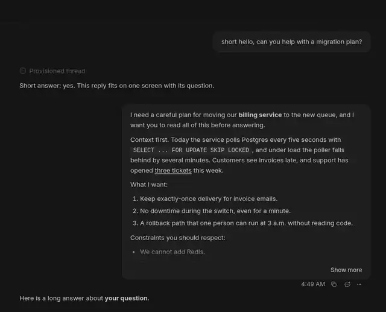
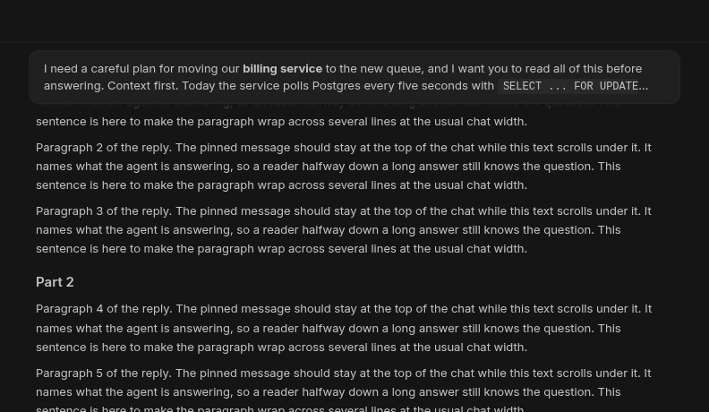
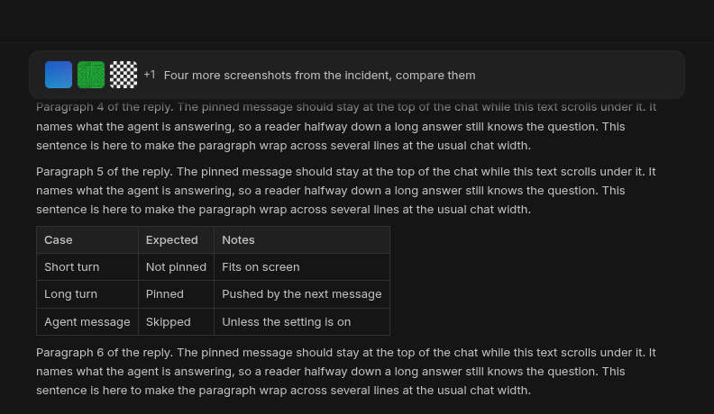

# Sticky Prompt

A BB plugin that keeps the message you are reading a reply to pinned at the
top of the chat, as Cursor does. Click the pinned message to scroll back to it.



The same demo as a video: [docs/demo.mp4](docs/demo.mp4).





## Behaviour

- As soon as your message reaches the top of the chat, a full-width copy of
  it, cut to two lines, stays pinned there.
- As your next message comes up to the top, it pushes the pinned one away
  and takes its place.
- A turn that fits on screen is not pinned: you can already see your
  message and the end of the reply together.
- The text is drawn by BB's own Markdown component, so code, bold and links
  look as they do in your message. Paragraphs and list items run together
  on one line. Code blocks show as inline code; tables and images in the
  text are left out.
- A message with images shows up to three small thumbnails, then a count of
  the rest.
- Scrolling with the pointer or a finger on the bar scrolls the chat.
- By default only messages you typed are pinned. Messages from other
  threads, agents and BB system notices are skipped.

## Settings

Open Settings, then Installed plugins, then Sticky Prompt, or use
`bb plugin config sticky-prompt`.

| Setting | Default | Effect |
| --- | --- | --- |
| `enabled` | on | Show the pinned message. |
| `includeOtherSenders` | off | Also pin messages from agents, other threads and BB. |

## Diagnostics

- `bb sticky-prompt senders <thread-id> [--last <n>]` lists a thread's newest
  user messages, who sent each one, and whether the bar would pin it.
- `bb sticky-prompt images <thread-id> [--last <n>]` reads the images of a
  thread's newest user messages the way the bar loads its thumbnails.

## How it works

- A message metadata slot that renders nothing records each message BB shows:
  its thread, its row in the timeline and who sent it.
- An app overlay draws one bar per chat. It reads the thread's list of user
  messages with `sdk.threads.conversationOutline`, so it can still name a
  message that BB has unmounted from a long thread.
- For the pinned message it reads the full text and attachments with
  `sdk.threads.message`. For a message whose sender it has not seen, it uses
  BB's text prefixes (`[bb system]`, `[bb message from thread:`) or the same
  lookup.
- Project images are read with `sdk.projects.attachments.read`. Web images
  load from their own address, as they do in the chat.

The bar finds rows through BB's timeline markup (`data-timeline-row-id`,
`data-timeline-row-list`, `data-timeline-window-spacer`). That markup is not
a public API. If a BB update changes it, the bar stops showing and the chat
keeps working.

## Development

```sh
npm install
npm test
npm run typecheck
bb plugin build
```
